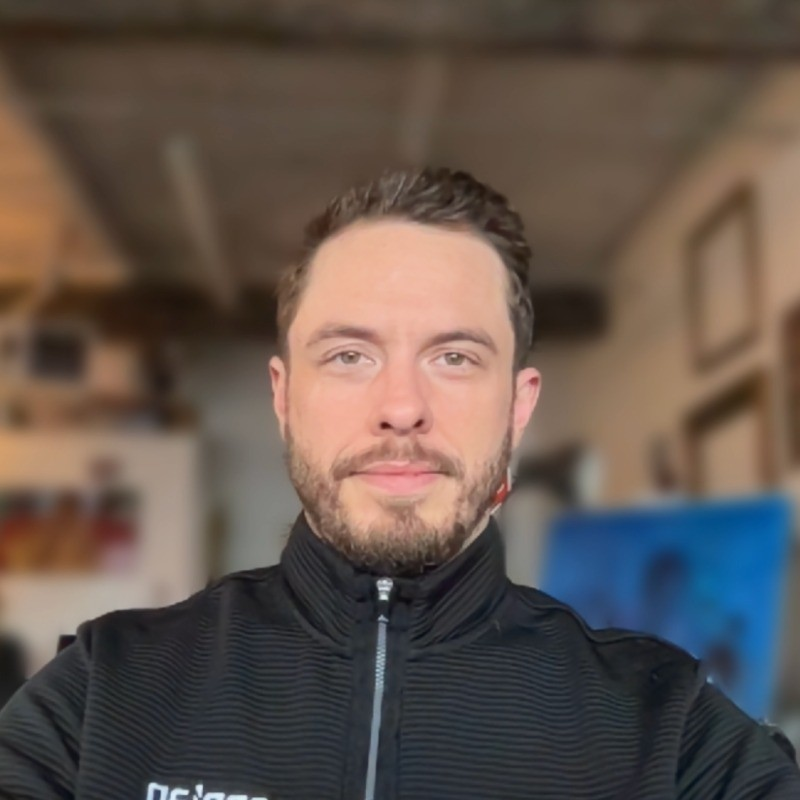
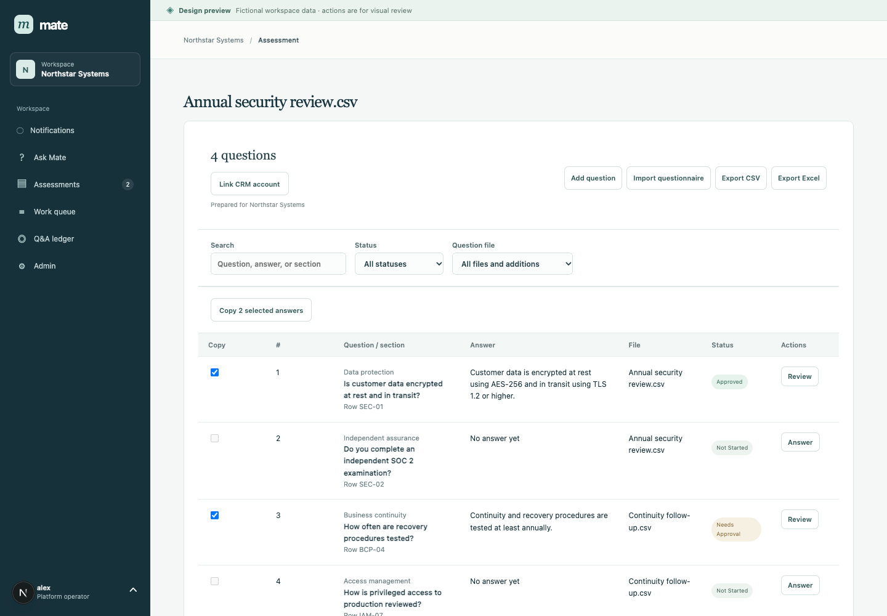
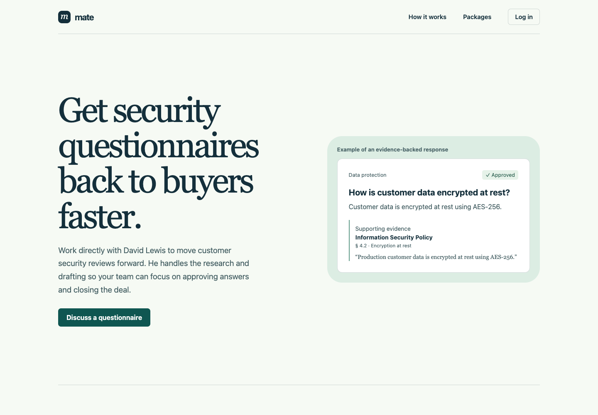
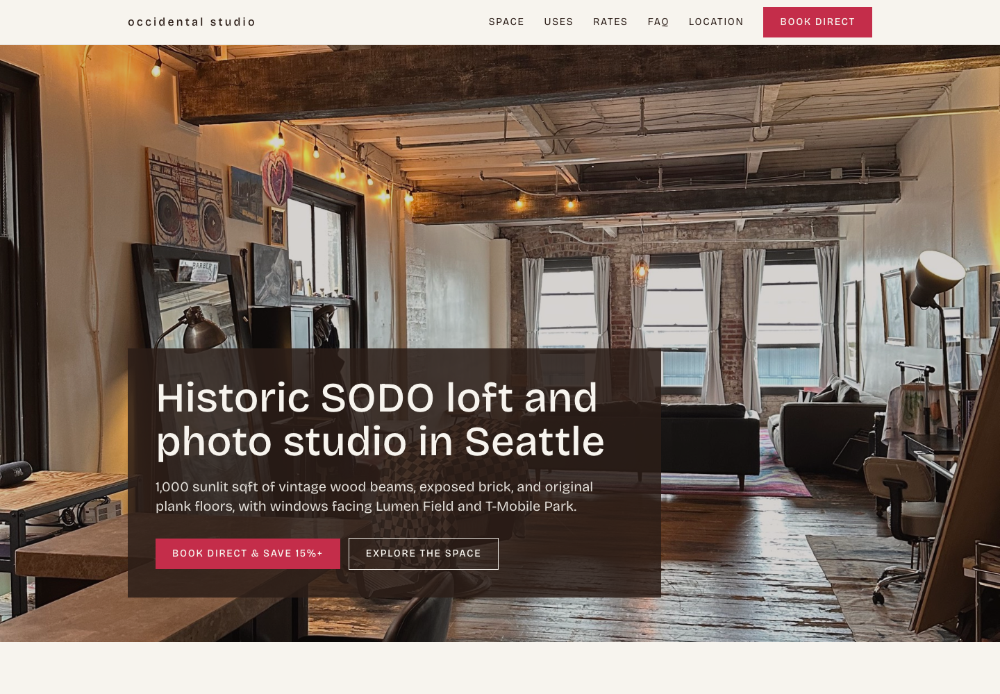

# David Lewis Makes

A Next.js portfolio for Sales Engineering and applied AI work. Project filters and expandable project summaries are implemented in the App Router.

```sh
npm ci
npm run dev
```

Open http://localhost:3000. No API keys or environment file are required. Client work is summarized at a high level. The public source includes no client materials or private project history.

## Screenshots

Public site captures and a synthetic-data application preview. The preview does not contain customer records.





